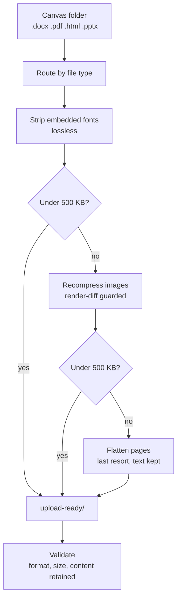

# CoEqual Submission Prep

Turn a Canvas bulk-download folder into a set of files CoEqual will accept, without damaging the
content being graded.

This repository packages a reusable workflow, an agent skill, and a working command-line tool for
converting Canvas submission exports into CoEqual-ready `.docx` and `.pdf` files under the
platform's 500 KB cap — with verification at every step, so a file that got smaller is never
mistaken for a file that survived.

Companion to [coequal-assignment-creator](https://github.com/dalalbhavik01/coequal-assignment-creator),
which creates the assignment. This one prepares the submissions that go into it.

## At A Glance



The organising principle is an escalation ladder: apply the cheapest, least destructive fix
first, and stop the moment the file clears the cap. Most files never get past the first rung.

## Why It Is Not Just "Compress The Files"

- **The bulk of a file is usually not the content.** Word embeds multi-megabyte font subsets. A
  1.7 MB submission can be 15 KB of text wrapped in 3.2 MB of fonts — compressing its images
  would destroy quality for no reason.
- **The thing being graded often lives inside the images.** Statistical output, charts and model
  tables arrive as screenshots. Compress too hard and the p-values become unreadable: you have
  met the size cap and ruined the submission.

So the work is diagnostic before it is destructive.

## What It Does

- Converts Canvas text-box entries (`.html`) into accepted documents.
- Converts `.pptx` decks to PDF with full visual fidelity.
- Strips cosmetic embedded fonts losslessly, which alone resolves most oversized Word files.
- Recompresses embedded images only as far as needed, and rejects any rewrite that visibly
  changes the page.
- Falls back to flattening with an invisible text layer rather than shipping an unreadable file.
- Validates every output: format, size, and content retention.
- Checks the batch, not just the files — missing deliverables and merged course sections are
  invisible per-file and change grades.
- Identifies files that cannot be fixed — `.gdoc` link stubs, Office lock files, missing
  deliverables — instead of silently passing them through.
- Leaves originals untouched and is safe to re-run.

## Primary Trigger

```text
\prep-submissions [folder of Canvas submissions]
```

Or run the tool directly:

```bash
python tools/prep_submissions.py ~/Downloads/submissions
```

It writes validated copies to `<folder>/upload-ready/` and leaves the originals in place.
Flags: `-o/--out` for a different output folder, `--limit` to change the byte cap.

## Hard Limits

CoEqual accepts **only `.docx` and `.pdf`** and caps each file at **500,000 bytes**. The cap is a
hard reject, not a working target.

One upload set per assignment — never merge batches. A cohort reflection (one file per team) and
a group assignment (two files per team) are separate CoEqual assignments even when the teams are
identical.

## Format Routing

| Input | What it is | Treatment |
|---|---|---|
| `.docx` | accepted | strip fonts → recompress images |
| `.pdf` | accepted | lossless re-save → downsample images |
| `.html` / `.txt` | Canvas text-box entry | convert to `.docx` |
| `.pptx` | slide deck | export to PDF, then run the PDF ladder |
| `.gdoc` / `.gsheet` | a link stub, not a document | cannot be fixed — always a failed submission |
| `~$*.pptx` | Office lock file, ~165 bytes | not a submission; exclude |

A `.gdoc` is roughly 180 bytes of JSON holding a Drive document ID. There is no content to
convert and no tooling fix. Ask the student to re-export as PDF.

## Verification

Size is the easiest thing to check and the least important. Every run confirms:

- Text retained — word-set diff before and after, not a character count
- Slide count equals page count for converted decks
- Archives still open and every XML part still parses
- Legibility, by actually extracting and reading a recompressed image when the graded artefact
  lives inside it

Two known false alarms — PowerPoint theme GUIDs inflating apparent text loss, and leftover
source files reading as conversion failures — are documented in
[skills/prep-submissions/references/verification.md](skills/prep-submissions/references/verification.md).

## Privacy

Submission folders hold real student names, grades and written work. This repository is public.

`.gitignore` excludes `submissions/`, `outputs/`, `upload-ready/`, `grades/`, `solutions/` and
every document extension. Keep it that way. Do not commit a submission, a grade export, or a
sample file "for testing".

## Repository Structure

```text
.
|-- README.md
|-- requirements.txt
|-- docs/
|   |-- pipeline-diagram.mmd
|   |-- portable-workflow.md
|   `-- verification-checklist.md
|-- skills/
|   `-- prep-submissions/
|       |-- SKILL.md
|       `-- references/
|           |-- batch-integrity.md
|           |-- pipeline.md
|           |-- verification.md
|           `-- troubleshooting.md
`-- tools/
    `-- prep_submissions.py
```

## Quick Start

1. `pip install -r requirements.txt`
2. Download the submissions from Canvas as a bulk export.
3. Run `python tools/prep_submissions.py <folder>`.
4. Read the per-file report — in particular any file it could not fix.
5. Move the consumed originals to the Trash so the source folder shows only what still needs
   attention.
6. Upload `upload-ready/` to the matching CoEqual assignment.

## Setup On Another Device

- **Agent skill:** copy `skills/prep-submissions` into the target agent's skills folder.
- **Any other agent:** paste [docs/portable-workflow.md](docs/portable-workflow.md) as the
  operating prompt.
- **Tool only:** copy `tools/prep_submissions.py` and `requirements.txt`.

The tool has no configuration and no account state — it reads a folder and writes a folder.

Before signing off on a batch, run [docs/verification-checklist.md](docs/verification-checklist.md).

## Core Principle

A file that got smaller is not the same as a file that survived. When the graded artefact is a
screenshot of statistical output, the only check that matters is whether the numbers are still
readable — so verify by looking, and when a file cannot be fixed without damage, say so and
leave the original intact.
